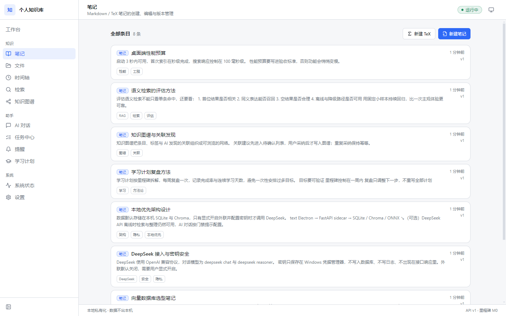
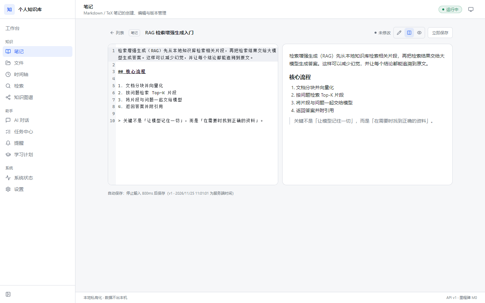
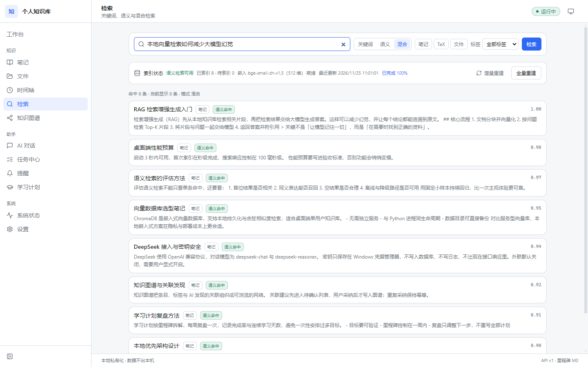
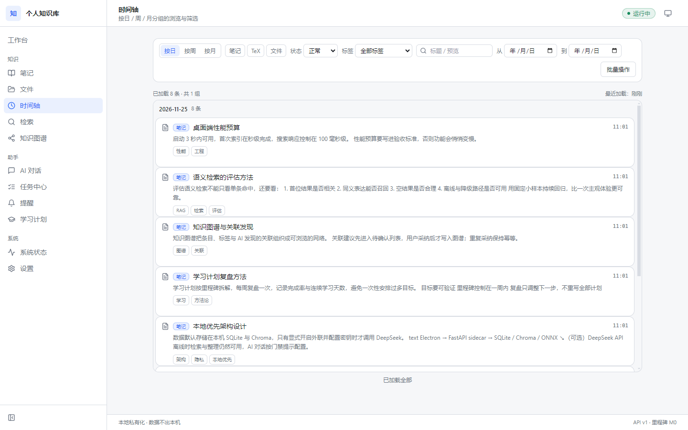
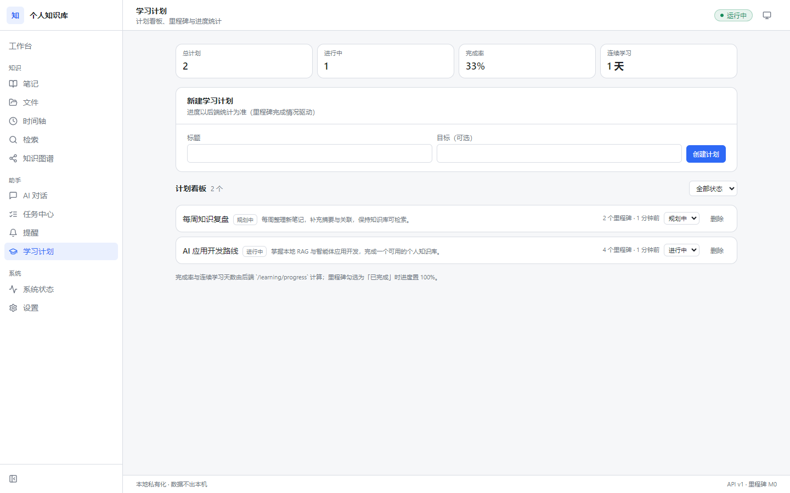
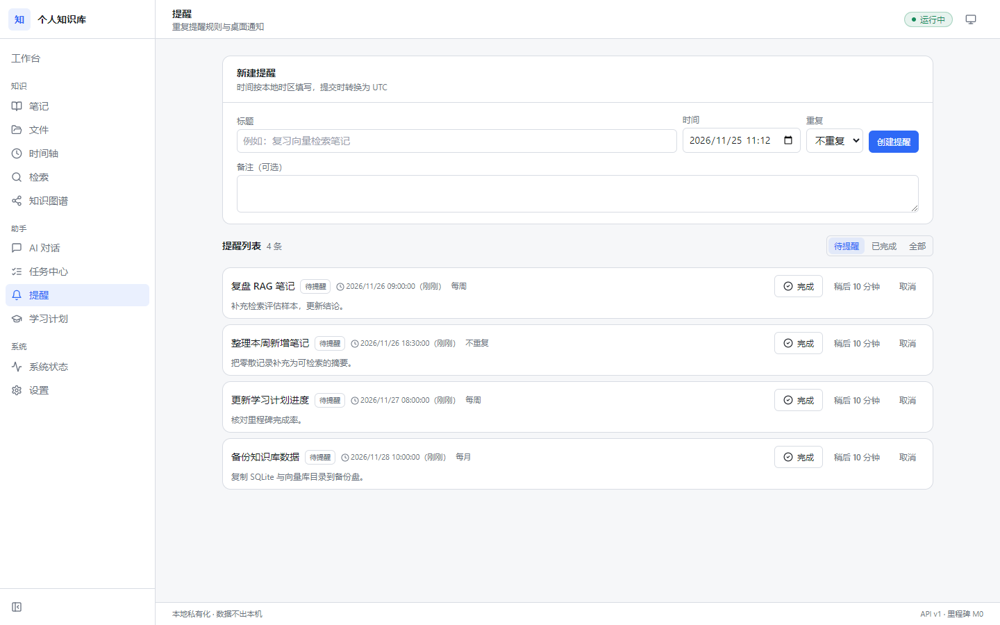
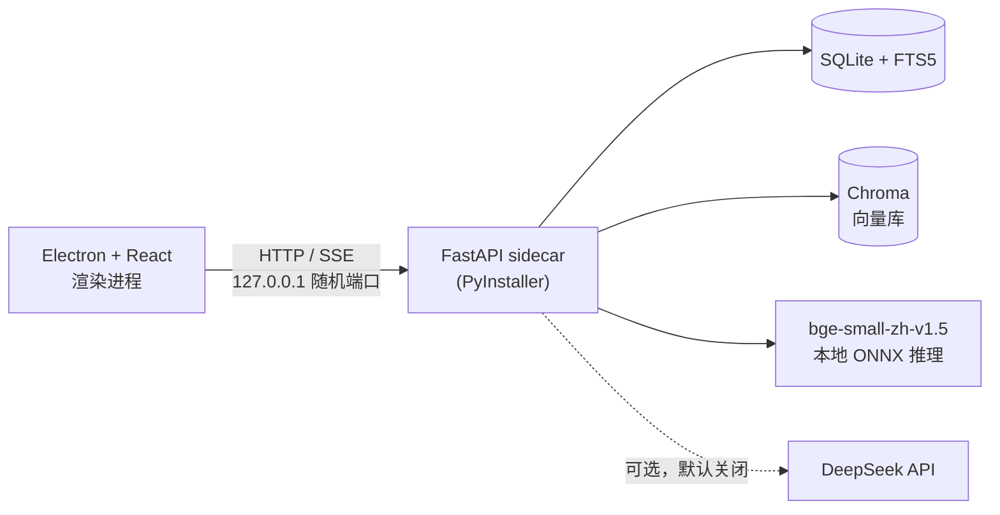

<div align="center">


# 个人专属智能知识库

**本地优先的 Windows 知识库桌面应用**<br />
笔记 · TeX · 文件 · 离线语义检索 · AI 整理 · 提醒 · 学习计划 · 知识图谱

[](https://github.com/thetkmf/agent-library/releases)
[](#系统要求)
[](LICENSE)
[](https://github.com/thetkmf/agent-library/actions/workflows/backend-ci.yml)
[](https://github.com/thetkmf/agent-library/actions/workflows/frontend-ci.yml)

[下载内测版](https://github.com/thetkmf/agent-library/releases/tag/v0.1.0-beta.1) · [文档](docs/) · [问题反馈](https://github.com/thetkmf/agent-library/issues)

</div>

> **当前版本：`v0.1.0-beta.1`（未签名内测版）**。安装包未做代码签名，Windows 首次运行会提示「未知发布者」；适合内部试用与反馈，不建议直接作为正式版分发。详见[已知限制](#已知限制)。

## 界面预览

| 笔记与标签 | Markdown / TeX 编辑器 |
| --- | --- |
|  |  |

| 语义 / 混合检索（内置离线模型） | 时间轴 |
| --- | --- |
|  |  |

| 学习计划与进度 | 提醒 |
| --- | --- |
|  |  |

## 功能

- **多形态知识管理**：Markdown 笔记、TeX 便签、文件附件；标签、时间轴、软删除与回收站、版本冲突保护。
- **本地检索**：SQLite FTS5 关键词检索 + Chroma 向量检索 + RRF 混合排序；内置 `bge-small-zh-v1.5`（ONNX，512 维），断网可用。
- **AI 助理**：DeepSeek 流式对话、知识库工具调用与引用；摘要、打标、关联、画像、知识图谱等后台任务；建议先确认后生效。
- **提醒与学习**：重复提醒、桌面通知、稍后提醒；学习计划、里程碑、完成率与连续学习天数。
- **知识图谱**：关系抽取、力导向图、子图查询与统计。
- **隐私优先**：数据默认只存本机；无遥测；AI 外联默认关闭；API Key 只写入 Windows 凭据管理器。

## 下载与安装

### 系统要求

| 项目 | 要求 |
| --- | --- |
| 操作系统 | Windows 10 1809+ / Windows 11，x64 |
| 内存 | 4 GB 以上（建议 8 GB） |
| 磁盘 | 约 600 MB（安装后含离线模型） |
| 运行时 | 无需安装 Python / Node.js |
| AI 功能 | 可选，需要自备 DeepSeek API Key |

### 安装步骤

1. 从 [Releases](https://github.com/thetkmf/agent-library/releases/tag/v0.1.0-beta.1) 下载 `PersonalKnowledgeBase-0.1.0-setup.exe`。
2. 校验文件（可选）：

   ```powershell
   Get-FileHash .\PersonalKnowledgeBase-0.1.0-setup.exe -Algorithm SHA256
   ```

   当前安装包 SHA256：

   ```text
   98df65d951a3d121dba6f973465580b5d9ee9fc4e0fb0660700491b1110a7bbf
   ```

3. 运行安装程序。若出现 SmartScreen 提示，选择「更多信息」→「仍要运行」。
4. 首次启动会初始化本地数据目录与访问 token；后端与离线模型随安装包提供，无需联网下载。
5. 如需 AI 功能，在「设置」中填入 DeepSeek API Key，并显式开启外联开关。

### 数据位置与备份

| 内容 | 默认位置 |
| --- | --- |
| 用户数据、数据库、日志 | `%APPDATA%\PersonalKnowledgeBase\` |
| 数据库 | `%APPDATA%\PersonalKnowledgeBase\data\db\pkb.sqlite3` |
| 向量库 | `%APPDATA%\PersonalKnowledgeBase\data\` 下的 Chroma 目录 |
| 日志 | `%APPDATA%\PersonalKnowledgeBase\logs\` |

卸载应用不会删除用户数据。升级或回滚前，建议先退出应用并完整复制 `%APPDATA%\PersonalKnowledgeBase\data`。

## 架构



- 桌面壳只负责窗口、IPC 与 sidecar 生命周期；业务数据全部经由本地 API。
- 后端绑定 `127.0.0.1` 随机端口，每次启动生成 Bearer token。
- 嵌入模型随安装包分发，离线加载，不写模型缓存。
- DeepSeek 是唯一外部 AI 供应商，只有用户配置 Key 并开启外联后才会调用。

## 技术栈

| 层 | 技术 |
| --- | --- |
| 桌面 | Electron 33、TypeScript、Vite |
| 前端 | React 18、React Router、TanStack Query、Tailwind CSS |
| 后端 | Python 3.11、FastAPI、SQLAlchemy 2、Alembic、APScheduler |
| 数据 | SQLite（WAL / FTS5）、ChromaDB |
| 嵌入 | BAAI/bge-small-zh-v1.5（ONNX Runtime，512 维） |
| AI | DeepSeek（OpenAI 兼容协议，httpx 直连） |
| 打包 | PyInstaller（backend sidecar）+ electron-builder（NSIS） |
| 契约 | OpenAPI 3.1，前端类型由契约生成 |

## 开发

### 环境

- Windows 10/11 x64
- Node.js ≥ 20（仓库提供 `.nvmrc` / `.node-version`）
- Python 3.11

### 本地运行

```powershell
git clone https://github.com/thetkmf/agent-library.git
cd agent-library

# 后端
cd backend
python -m venv .venv
.venv\Scripts\activate
pip install -e ".[dev]"

# 前端（另开终端）
cd ..\desktop
npm ci
npm run dev
```

开发态默认连接本地后端；没有嵌入模型时会以降级的关键词检索运行。打包或完整语义检索需要模型目录，见 [docs/开发过程.md](docs/开发过程.md) 第 13.23 节。

### 测试与质量门禁

```powershell
# 后端
cd backend
ruff check .
mypy app
pytest
python ..\scripts\export_openapi.py --check

# 前端
cd desktop
npm run typecheck
npm run lint
npm test
npm run build
npm run e2e
```

### 目录结构

```text
backend/          FastAPI 服务、迁移、OpenAPI 契约、测试
desktop/          Electron 主进程、preload、React 渲染进程、E2E
docs/             接口标准、开发规范、协作流程、发布验收记录
scripts/          进度检查、OpenAPI 导出/校验
.github/          CI、Issue 与 PR 模板
```

### 契约与文档

- 人类可读接口约定：[`docs/开发接口标准.md`](docs/开发接口标准.md)
- 机器可读契约：[`backend/openapi.json`](backend/openapi.json)
- 前端生成类型：`desktop/src/api/generated.ts`（禁止手改）
- 开发流程与任务看板：[`docs/开发过程.md`](docs/开发过程.md)
- 编码规范：[`docs/开发规范.md`](docs/开发规范.md)

## 隐私与安全

- **本地优先**：笔记、文件、向量与画像默认只保存在本机。
- **无遥测**：不收集使用统计，不内嵌第三方分析 SDK。
- **密钥隔离**：DeepSeek API Key 存储在 Windows 凭据管理器，不进入数据库、日志或接口响应。
- **外联可控**：外部 AI 调用默认关闭，需要用户显式开启；本地检索与文件管理不依赖外网。
- **本地端口与 token**：后端仅监听回环地址，使用每次启动生成的 Bearer token。

发现安全问题请不要公开提交 Issue，参见 [SECURITY.md](SECURITY.md)。

## 已知限制

- 安装包**未代码签名**，SmartScreen 会提示未知发布者；对外正式分发前应补签名。
- 仅支持 **Windows x64**，暂无 macOS / Linux 版本。
- 暂无自动更新；升级需下载新安装包覆盖安装。
- 跨版本降级尚未实测；升级/回滚前请备份 `%APPDATA%\PersonalKnowledgeBase\data`。
- 「工作台」总览页仍为占位页，当前从左侧导航进入笔记、检索等页面。
- 单用户、本地单机使用；暂不支持多设备同步或多人协作。
- AI 功能需要用户自备 DeepSeek API Key，并受 DeepSeek 服务条款约束。

## 参与贡献

欢迎提交 Issue 与 Pull Request。请先阅读 [CONTRIBUTING.md](CONTRIBUTING.md) 与 [docs/开发规范.md](docs/开发规范.md)。

## 许可证

本项目代码以 [MIT License](LICENSE) 发布。

安装包内含 BAAI/bge-small-zh-v1.5 模型（MIT）等第三方组件，完整归属与许可证见 [THIRD_PARTY_NOTICES.md](THIRD_PARTY_NOTICES.md)。

## 致谢

- [BAAI/bge-small-zh-v1.5](https://huggingface.co/BAAI/bge-small-zh-v1.5) — 中文文本嵌入模型
- [FastAPI](https://fastapi.tiangolo.com/)、[Electron](https://www.electronjs.org/)、[React](https://react.dev/)、[Chroma](https://www.trychroma.com/)
- [DeepSeek](https://www.deepseek.com/) — 可选的外部 AI 服务
